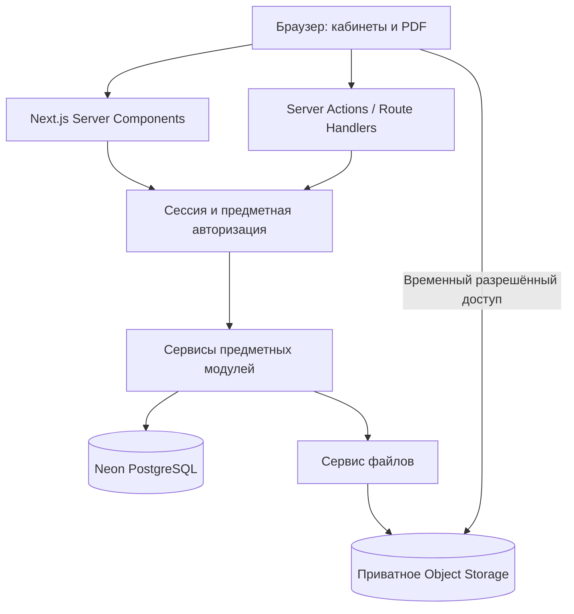
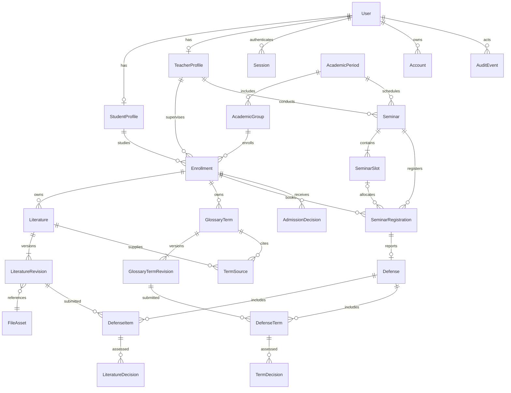

# Engxam — архитектура приложения

Версия: 1.4. Дата: 14 ноября 2026 года.

Статус: архитектурное решение для реализации после согласования документа. Решения пользователя зафиксированы в разделе 2; остальные продуктовые настройки явно обозначены как проектные значения по умолчанию. Код приложения и миграции этим документом не создаются.

## 1. Источники и границы

- [Исходное ТЗ](ENGXAM_V1.md).
- [Таблица предыдущей группы](Иностранный%20язык.%20Таблица.xlsx): пример накопительного учёта, не источник данных для импорта.
- [Бланк преподавателя](2026_27_Бланк_допуска_к_канд_экз_по_ин_яз_.docx): требования к литературе, словарю и состав полей допуска.
- Ответы заказчика в обсуждении архитектуры имеют приоритет над предварительными решениями ТЗ.

MVP охватывает подготовку, библиотеку, словарь, еженедельные отчёты, запись на семинары и решение преподавателя о допуске. Письменный перевод, проведение экзамена, экзаменационные оценки, импорт старой таблицы исключены. Автоматический подсчёт PDF, OCR, рассылки и экспорт заполненного бланка — последующие возможности, не критерии готовности MVP. Экран истории должен содержать данные, необходимые для будущего экспорта.

## 2. Согласованные бизнес-решения

1. Признание материала пригодным и зачёт объёма — одно действие преподавателя. Отдельного обязательного предварительного одобрения PDF нет.
2. Можно принять отдельные статьи из пакета и часть главы монографии. Повторные попытки разрешены, повторный зачёт того же текста запрещён.
3. Фрагмент описывается главой и диапазоном страниц. Произвольные части страницы в MVP не моделируются.
4. Знаки считаются с пробелами, без библиографии и сносок. Объём заявляет студент; преподаватель подтверждает или исправляет.
5. Новые термины обсуждаются еженедельно. Нужны массовый ввод через textarea и действие преподавателя «Допустить до экзамена».
6. Четверг: 19:00–20:20 и 20:40–22:00, восемь основных мест по 20 минут и два резервных.
7. Только подготовка и допуск; старые данные не импортируются.
8. Для допуска учитываются принятые преподавателем термины; допуск выдаётся вручную.
9. Нет раннего закрытия записи в среду. Все основные сценарии полноценно работают на ПК и телефоне.

## 3. Разрешение неоднозначностей и проектные допущения

| Неоднозначность | Решение |
| --- | --- |
| Accepted у всей книги и частичные защиты | Решение принадлежит результату по диапазону страниц, а не книге. У книги отображаются агрегаты «нет зачётов / частично зачтено / зачтено полностью» |
| «Изучено» означает весь загруженный PDF | Показать отдельно объём библиотеки, заявленный к защите и зачтённый объём. Загрузка книги не доказывает её изучение |
| Два резерва не помещаются в расписание | Это очередь ожидания без времени и без обещания выступления. Преподаватель переводит резервиста в освободившийся основной слот |
| Одна глава принимается частично | Результат разбивается на непересекающиеся диапазоны страниц; по каждому указывается решение и объём |
| Главы могут начинаться на одной странице | Для контроля пересечений используется физический номер страницы единого PDF; название главы не позволяет зачесть ту же страницу дважды |
| В бланке «около 600 000», в ТЗ «не менее» | Проектный порог готовности 600 000; изменение цели доступно администратору с аудитом |
| 500 внесённых слов не равны 500 обсуждённым | Вести два счётчика: внесено уникальных и принято преподавателем. Для готовности использовать принятые |
| Регистрация и редактирование профиля | По умолчанию аккаунты создаёт администратор; открытая регистрация выключена. Студент меняет тему и руководителя, ФИО/группу/преподавателя — администратор |
| Запись без раннего закрытия | Дедлайна в среду нет. На свободный будущий слот можно записаться и во время семинара. Студент отменяет основное место до начала своего слота; далее посещением управляет преподаватель. Резерв доступен до окончания открытого семинара |
| Финальное решение о допуске | Ручное решение преподавателя при выполнении обоих порогов; обход порогов в MVP не предусмотрен |

Учёт принятых терминов, отсутствие закрытия записи в среду и ручная выдача допуска подтверждены заказчиком. Правила регистрации аккаунтов, границы самостоятельной отмены и последствия отзыва зачётов остаются проектными решениями.

## 4. Архитектура и технический стек

Модульный монолит Next.js App Router, TypeScript strict, Server Components для чтения, Client Components для интерактивных форм и просмотра PDF. Server Actions вызывают серверные сервисы; Route Handlers обслуживают авторизацию и файлы. Отдельного backend нет.

PostgreSQL в Neon — источник истины. Предлагается Drizzle ORM с SQL-миграциями для ограничений, не выражаемых ORM. Better Auth отвечает за аккаунты и сессии; приложение — за предметные права. Хранилище PDF — Neon Object Storage, деплой — Vercel. Версии зависимостей фиксируются при начале реализации после проверки совместимости, без плавающих latest в воспроизводимой сборке.



Модули: identity, education, literature, glossary, seminars, defenses, admission, files, audit. Общий слой содержит только техническую инфраструктуру и общие примитивы. Правила зачёта сосредоточены в defenses, готовность и допуск — в admission; UI не дублирует их.

### Уточнения по результатам этапов 01–02

Авторизация реализована через Managed Neon Auth (Better Auth) и @neon/auth/next; системные таблицы принадлежат Neon, приложение их не мигрирует. Предметный User реализован таблицей app_user с уникальным auth_id, собственной ролью и active. Роль admin синхронизируется с административной ролью Auth для создания аккаунтов, но предметные разрешения всегда проверяются по app_user. Остальные пользователи имеют роль user в Auth и teacher/student в приложении.

Первый администратор настраивается операторским скриптом после создания Auth-идентичности и назначения ей admin через CLI. Повторная начальная выдача при существующем администраторе запрещена. Новые аккаунты создаёт администратор в кабинете; пользователь устанавливает пароль по email OTP, случайный начальный пароль не показывается. Публичная регистрация закрыта в приложении и сервисе Auth. Деактивация включает ban, отзыв сессий и серверную проверку active.

Enrollment дополнен period_id для ограничения UNIQUE(student_id, period_id); составной FK (group_id, period_id) гарантирует соответствие группе. Это контролируемое дублирование, а не независимое редактируемое поле потока в профиле. Интерфейсы трёх ролей пока объединены маршрутом /account; серверные query и service сохраняют разграничение. Подробности реализации и проверок — [отчёт этапа 02](stages/02_REPORT.md).

## 5. ER-модель

Все предметные сущности имеют UUID PK, created_at; изменяемые — updated_at и version для оптимистической блокировки. Время событий — timestamptz, календарные учебные даты — date. Числа знаков и слов — неотрицательные целые, без float. Обязательные FK запрещают удаление используемой истории.



Диаграмма показывает основные связи; технические Verification, Invitation и IdempotencyRequest описаны ниже. Связи reviewer_id и actor_id с User обязательны для решений и аудита, но опущены на диаграмме ради читаемости.

### 5.1. Пользователи и организация

| Сущность | Поля и ограничения |
| --- | --- |
| User | email UNIQUE по нормализованному значению, name, role: admin/teacher/student, active. Одна роль в MVP |
| Session, Account, Verification | Схема и миграции Better Auth; собственные пароли и токены не реализуются |
| Invitation | email, token_hash UNIQUE, expires_at, used_at, invited_by; одноразовое приглашение, если выбран этот способ выдачи доступа |
| StudentProfile | user_id UNIQUE FK, full_name |
| TeacherProfile | user_id UNIQUE FK, full_name |
| AcademicPeriod | name, starts_on, ends_on, preparation_deadline, target_characters=600000, target_terms=500, timezone=Europe/Moscow, status |
| AcademicGroup | period_id, name; UNIQUE(period_id, name) |
| Enrollment | student_id, group_id, teacher_id, specialty, language=en, dissertation_topic, supervisor_name, status; UNIQUE(student_id, group_id). Поток определяется через группу |

Учебные данные принадлежат Enrollment, а не пожизненному профилю. Это сохраняет историю при новом потоке. Перевод между группами одного потока — отдельная административная операция, не создание дубликата обучения; два активных обучения одного студента в одном потоке запрещаются транзакционной проверкой под блокировкой StudentProfile. Смена преподавателя сохраняет авторов прошлых решений, доступ переходит новому преподавателю. Старый преподаватель теряет текущий доступ к данным студента.

### 5.2. Литература и файлы

Этап 03 реализован: [отчёт и ограничения](stages/03_REPORT.md). Ревизии дополнительно сохраняют DOI и тип материала как исторический снимок; библиотека открывается по /library?enrollmentId=UUID. Для этапа 06 в Literature предусмотрены file_locked_at и pending_defense_count — обновлять вместе с результатами и состояниями защит. Файловый сервис использует неизменяемую запись проверенных байтов, а не копирование потенциально изменяемого временного объекта.

| Сущность | Поля и ограничения |
| --- | --- |
| Literature | enrollment_id, material_type: article/monograph/collection, canonical_doi nullable, archived_at, current_revision_id. Логическая работа, общая для всех её версий |
| LiteratureRevision | literature_id, revision_no, title, authors, publication_year, publication_source, url, publication_pages_text, declared_characters, declared_words nullable, file_id, page_count, created_by; UNIQUE(literature_id, revision_no) |
| FileAsset | enrollment_id, storage_key UNIQUE, original_name, detected_mime, size_bytes, sha256, status: uploading/ready/failed/deleting/deleted, uploaded_by |

Печатные страницы издания хранятся для библиографии; для диапазонов применяется сквозная нумерация страниц PDF с 1. Это исключает неоднозначность римских страниц и повторяющейся нумерации сборников. Главы и названия статей сборника — подписи диапазонов. Отдельная постоянно изменяемая LiteratureSection не нужна: защищаемый фрагмент является DefenseItem, а подтверждённый — LiteratureDecision.

Замена PDF после первого зачёта в MVP запрещена: изменение пагинации разрушает контроль пересечений. Метаданные можно исправить новой ревизией при неизменном PDF. До зачётов замена разрешена только без открытых отправленных пакетов; отменённые попытки сохраняют старую ревизию. Ошибочно загруженную книгу после зачётов исправляют через отзыв её зачётов с причиной, затем замену и новые решения. Старые документы не перезаписываются.

DOI нормализуется; повторный DOI в библиотеке одного обучения отклоняется. Совпадение хеша PDF в том же обучении ведёт к существующей карточке. Совпадение названия/авторов вызывает предупреждение. Эти меры не доказывают идентичность разных сканов и изданий: повторяющийся текст в разных файлах контролирует преподаватель. Автоматического семантического антиплагиата нет.

### 5.3. Семинары и защиты

| Сущность | Поля и ограничения |
| --- | --- |
| Seminar | period_id, teacher_id, starts_at, ends_at, status: draft/open/closed/completed/cancelled; UNIQUE(teacher_id, starts_at) |
| SeminarSlot | seminar_id, position 1..8, starts_at, ends_at; UNIQUE(seminar_id, position) |
| SeminarRegistration | seminar_id, enrollment_id, slot_id nullable, queue_position nullable 1..2, status: booked/waitlisted/attended/no_show/cancelled; резерв без slot_id |
| Defense | registration_id UNIQUE, status: draft/submitted/finalized/cancelled, summary_ru, submitted_at, review_started_at nullable, reviewer_id nullable, finalized_at |
| DefenseItem | defense_id, literature_revision_id, chapter_label, page_from, page_to, declared_characters, declared_words nullable |
| LiteratureDecision | defense_item_id, literature_id, page_from, page_to, outcome: accepted/rejected, confirmed_characters, confirmed_words nullable, reviewer_id, reviewed_at, comment, revoked_at, revoked_by, revocation_reason |
| DefenseTerm | defense_id, term_revision_id; UNIQUE(defense_id, term_revision_id). Фиксирует состав слов на обсуждение до появления решения |
| TermDecision | defense_term_id, term_revision_id, outcome: accepted/rejected, reviewer_id, reviewed_at, comment, revoked_at, revoked_by, revocation_reason. Составной FK обеспечивает соответствие ревизии выбранному DefenseTerm |

LiteratureDecision.literature_id — контролируемое дублирование ключа для ограничения пересечений; соответствие работе исходной ревизии обеспечивается составными FK через DefenseItem. Аналогично составные FK или constraint triggers обеспечивают одного владельца обучения у файлов, терминов, источников, материалов и защиты. Одних проверок перед INSERT недостаточно для конкуренции.

### 5.4. Словарь, допуск и технические записи

| Сущность | Поля и ограничения |
| --- | --- |
| GlossaryTerm | enrollment_id, normalized_term, current_revision_id, archived_at; UNIQUE(enrollment_id, normalized_term), включая архив |
| GlossaryTermRevision | term_id, revision_no, term, translation nullable у черновика, definition, context; UNIQUE(term_id, revision_no) |
| TermSource | term_id, literature_id, locator nullable; UNIQUE(term_id, literature_id) |
| AdmissionDecision | enrollment_id, outcome: admitted/revoked, teacher_id, decided_at, reason, accepted_characters_snapshot, accepted_terms_snapshot, targets_snapshot, previous_decision_id nullable |
| AuditEvent | actor_id, action, entity_type, entity_id, happened_at, request_id, before/after с минимальным набором полей, reason |
| IdempotencyRequest | actor_id, operation, key, payload_hash, result_reference, created_at; UNIQUE(actor_id, operation, key) |

Текущая ревизия обязана принадлежать своему родителю: составной FK, а не произвольный UUID. Термины архивируются; повторное добавление архивного термина предлагает восстановить запись. Историческое принятие старой ревизии не превращается в принятие новой автоматически.

## 6. Бизнес-процесс защиты и начисления

1. Студент создаёт работу и загружает PDF. Ready у файла означает завершённую загрузку, не зачёт.
2. Записывается на семинар и формирует пакет: диапазоны страниц одной или нескольких работ, краткая характеристика на русском, новые термины. Можно представить только словарь.
3. Отправка фиксирует ревизии и состав пакета. До начала проверки можно отозвать отправку и редактировать черновик независимо от дня недели. Начало проверки фиксируется преподавателем (review_started_at, reviewer_id); после этого изменения выполняются через возврат на доработку. После первого решения пакет неизменяем. Отзыв и начало проверки конкурируют через блокировку Defense и проверку version.
4. Преподаватель обсуждает материал и принимает решение по диапазонам. Это одновременно признание пригодности и начисление объёма.
5. Для частичного зачёта преподаватель разбивает заявленный диапазон. Например, заявлены страницы 10–29; принимаются 10–19, отклоняются 20–29. Для принятой части вводится её собственный объём; пропорция по числу страниц автоматически не рассчитывается.
6. При завершении решения покрывают все страницы каждого DefenseItem без пересечений и пробелов. По каждому заявленному термину также есть решение. Отклонение требует комментария.
7. Не принятые диапазоны разрешено представить заново в новой Defense; старая попытка не перезаписывается. Два принятых материала и один отклонённый дают частично успешную защиту — это вычисляемая характеристика, не причина отменять весь пакет.

Преподаватель может принять отправленный пакет из карточки материала до занятия: дополнительной стадии предварительного одобрения нет, зачёт возникает сразу. Наличие записи задаёт контекст отчётности, но дата решения хранится отдельно от даты семинара. Отмена занятия или неявка сами по себе не отзывают уже сделанные решения.

### 6.1. Целостность и пересечения

- Диапазоны включают обе границы; в БД представляются как int4range(page_from, page_to + 1, '[)'). Проверки: 1 <= from <= to <= page_count.
- Для действующих accepted решений действует EXCLUDE USING gist по literature_id WITH = и диапазону WITH && (btree_gist). Разные главы не обходят это ограничение. Между ревизиями с тем же PDF действует тот же literature_id.
- Для rejected решений confirmed_characters=0; для accepted — положительное целое. Заявленное значение и подтверждённое сохраняются отдельно. Превышение заявленного допускается при исправлении преподавателем с комментарием; интерфейс показывает расхождение.
- Решения одной попытки не пересекаются независимо от outcome; находятся внутри исходного DefenseItem. Это проверяется при завершении в транзакции под блокировкой Defense. Проверки межстрочных сумм нельзя реализовывать обычным CHECK.
- В submitted пакетах одного обучения пересечения заявленных диапазонов той же работы запрещаются сервисом под блокировкой Literature. При финализации повторно проверяются зачёты; итоговая защита — constraint БД.
- Повторный запрос финализации с тем же ключом возвращает прежний результат. Тот же ключ с другим payload — конфликт.

При ошибочном решении преподаватель отзывает конкретный зачёт с причиной и создаёт новое решение. Значения принятого решения не редактируются на месте. Отзыв, новое решение, аудит и проверка действующего допуска выполняются атомарно. Все места начисления используют один серверный сервис.

## 7. Словарь и массовый ввод

Этап 04 реализован: [отчёт](stages/04_REPORT.md). Миграция 0004 включает составные FK источников и отложенный FK текущей ревизии своему термину. Пакетное сохранение использует bulk INSERT в транзакции, ключ идемпотентности и повторную проверку токена предпросмотра. Термины без перевода — черновики; сведения об источниках изменяют версию записи, сохраняя ревизию содержания. Принятие преподавателем остаётся этапом 06.

Textarea: одна запись на строку; поддерживаются «term» и «term<TAB>перевод». Для одиночного слова создаётся черновик без перевода; перевод обязателен перед отправкой на обсуждение. Не разбивать автоматически по дефису: он может быть частью термина. Определение и контекст можно дополнить в таблице предпросмотра.

Нормализация ключа: Unicode NFKC, trim, схлопывание пробелов, приведение регистра. Не выполнять стемминг и автоматическое объединение синонимов. Один термин/словосочетание — одна словарная единица, независимо от количества источников. Совпадающие ключи внутри пакета и с существующим словарём показываются в предпросмотре; принятую запись пакет не перезаписывает.

Проектные лимиты: до 500 строк и 100 КБ текста на запрос. Сервер повторяет валидацию предпросмотра. Подтверждение сохраняет валидные выбранные строки одной транзакцией; конфликт конкурентного редактирования возвращает обновлённый предпросмотр, без скрытой частичной записи. Возвращаются количества созданных, пропущенных дублей и ошибок с номерами строк.

Для еженедельного обсуждения выбираются конкретные ревизии новых/исправленных терминов. Преподаватель может выделить и принять их группой, но сервер создаёт отдельный TermDecision на каждый термин. В зачёт идут только активные термины, у текущей ревизии которых есть действующее принятие. Повторное принятие той же ревизии запрещено частичным UNIQUE. Исправление текста/перевода/определения/контекста создаёт ревизию и требует повторного принятия; добавление источника не меняет принятое содержание.

## 8. Прогресс и допуск

### Пакетное принятие терминов преподавателем

В карточке еженедельной защиты показывается фиксированный список отправленных новых/исправленных терминов, а не весь словарь из 500 записей. Преподаватель видит слово, перевод, контекст по раскрытию и количество элементов пакета. Действие «Принять все N терминов пакета» доступно без индивидуального выделения строк. Для исключений преподаватель помечает слова «На доработку», задаёт общую причину для группы либо отдельные комментарии. Итоговое действие явно показывает «Принять N, вернуть M». Можно также выбрать произвольную группу чекбоксами.

Пагинация и фильтр не меняют смысл команды: «все в пакете» относится ко всему снимку отправки, число указано явно; «выбрать видимые» — отдельное действие. Перед сохранением показан итог выбранного действия, без обязательных подтверждений каждого слова. Сервер проверяет весь список ID/ревизий, принадлежность и version пакета; сохраняет решения атомарно, с одним request_id и отдельной записью на термин. Изменение состава, конфликт или чужой ID отменяет всю операцию. Повтор запроса не создаёт новые зачёты. Предложенный лимит — 500 терминов в пакете.

Проверка литературы и словаря может сохраняться отдельно; Defense остаётся submitted с начатой проверкой, пока есть неоценённые позиции. Финализация запрещена до полного покрытия. Уже принятое можно только отозвать явно, а не перезаписать следующим массовым действием. В интерфейсе по умолчанию видны неоценённые позиции. Это обеспечивает одно массовое действие для обычной недельной порции и несколько действий только для исключений.

### Расчёт показателей

- Объём библиотеки: сумма заявленных объёмов текущих ревизий неархивных работ; это справочная оценка.
- Зачтённые знаки: SUM(confirmed_characters) по accepted LiteratureDecision без revoked_at, в рамках Enrollment. Архивирование карточки не отменяет зачёт.
- Внесённые термины: количество активных уникальных GlossaryTerm.
- Принятые термины: COUNT DISTINCT term_id с действующим принятием текущей ревизии.
- Проценты: фактический объём / цель × 100; полоса ограничена 100%, число и превышение сохраняются. Общий усреднённый процент не заменяет два независимых порога.
- Готовность: accepted_characters >= target_characters AND accepted_terms >= target_terms.
- Допуск: отдельное последнее решение AdmissionDecision; достижение порогов не выдаёт допуск автоматически.

Кнопка допуска доступна назначенному преподавателю. Транзакция блокирует Enrollment, заново считает показатели, сохраняет решение и снимок целей/результатов. Повторный действующий допуск запрещён. Интерфейс различает «не готов», «готов, ожидает решения», «допущен», «допуск отозван».

Все операции, меняющие зачёт, принятые термины и цели, используют согласованную блокировку Enrollment. Если после изменения пороги больше не выполнены, действующий допуск автоматически отзывается в той же транзакции с причиной и аудитом. Преподаватель может отозвать допуск вручную. Изменение целей потока требует предпросмотра затронутых студентов и атомарной переоценки их допусков; исходные снимки не меняются.

## 9. Расписание, резерв и конкуренция

| Основной слот | Время Europe/Moscow |
| --- | --- |
| 1 | 19:00–19:20 |
| 2 | 19:20–19:40 |
| 3 | 19:40–20:00 |
| 4 | 20:00–20:20 |
| Перерыв | 20:20–20:40 |
| 5 | 20:40–21:00 |
| 6 | 21:00–21:20 |
| 7 | 21:20–21:40 |
| 8 | 21:40–22:00 |

Два резерва — позиции очереди 1 и 2. Один студент занимает максимум одно активное место на семинаре, основное или резервное. При наличии очереди освободившийся слот сначала доступен для перевода резервиста преподавателем. Автоматическое назначение времени не выполняется: резервист может отсутствовать. Преподаватель выбирает присутствующего по очереди; пропуск первого требует причины. Перевод сохраняет историю и пакет материалов. По окончании занятия не выступившие резервисты получают отмену с причиной «резерв не использован», а не неявку.

Запись: начать транзакцию → заблокировать Seminar → проверить права, поток, назначенного преподавателя, статус и то, что выбранный слот ещё не начался → проверить слот/очередь → создать регистрацию → commit. Отмена и перевод резерва используют тот же порядок блокировки. Частичные уникальные индексы запрещают две неотменённые регистрации одного Enrollment на семинар, повторное назначение основного slot_id и повторную позицию активного резерва. Состояния attended/no_show продолжают занимать исторический слот; для замены неявившегося его регистрация переводится в cancelled с сохранённым событием неявки в аудите, затем слот выдаётся резервисту.

slot_id обязан принадлежать seminar_id — составной FK. У booked/attended/no_show есть slot_id и нет queue_position; у waitlisted — наоборот. cancelled сохраняет прежние значения для истории, но не участвует в ограничениях занятости. Статус посещения и отмена не стирают принятые результаты.

Пересекающиеся семинары одного преподавателя запрещены. Отмена семинара отменяет активные записи и незавершённые пакеты, но сохраняет финализированные решения. Перенос семинара с записями — отдельная команда с аудитом и явным показом нового времени; слоты не регенерируются поверх истории. По умолчанию преподаватель создаёт семинары только по четвергам, с возможностью отмены праздничных дат.

## 10. Права и безопасность

| Действие | Студент | Преподаватель | Администратор |
| --- | --- | --- | --- |
| Литература, словарь, PDF | Только своё обучение | Только назначенные студенты | Нет доступа к содержимому по умолчанию |
| Ввод и отправка материалов | Свои | Возврат на исправление | Нет |
| Принятие/отзыв зачётов, допуск | Нет | Назначенные студенты | Нет, если не назначена роль преподавателя |
| Семинары | Своё место, свободные слоты без чужих ФИО | Свои занятия и состав участников | Организационная настройка |
| Пользователи, группы, цели | Нет | Чтение назначенной структуры | Управление |

Проверка сессии, active, роли и принадлежности данных выполняется в каждой серверной операции и запросе файла. Маршрутизация и middleware не заменяют проверку внутри сервисов. Заблокированный аккаунт теряет сессии. Роли и ключи владельца из входящего payload не принимаются на доверии. Чужой идентификатор не раскрывает существование объекта.

Секреты только в серверной среде; приватные ответы не кэшируются публично. Проверка origin/CSRF для изменений, rate limit для входа, массового ввода и загрузок. Тексты отображаются с экранированием, URL допускают только http/https; сервер не скачивает произвольный URL литературы. PDF просматривается в изолированном просмотрщике; содержимое не исполняется как HTML приложения.

## 11. Жизненный цикл файлов

1. Сервер проверяет владельца и квоту, создаёт FileAsset(uploading) и уникальный ключ. Проектный предел PDF — 50 МБ, настраиваемый.
2. Браузер загружает напрямую в приватное хранилище по краткоживущему разрешению; большой PDF не проходит через тело Server Action.
3. Команда завершения проверяет существование, фактический размер, сигнатуру PDF, число страниц и контрольную сумму. Заявленные MIME и размер клиента недостаточны. Повреждённый/зашифрованный неподдерживаемый PDF отклоняется понятной ошибкой.
4. Только после проверки файл становится ready и связывается с ревизией. Повтор завершения идемпотентен. Финальный объект нельзя перезаписать старым upload URL: загрузка во временный ключ, затем фиксация неизменяемого конечного объекта.
5. Просмотр/скачивание: серверная авторизация и короткая подписанная ссылка; поддержка Range для PDF. Временная ссылка является bearer-доступом до истечения срока, поэтому срок минимален и ссылка не попадает в логи.
6. Исторические PDF сохраняются. Удаляются только неиспользуемые/незавершённые загрузки после периода ожидания. Очистка повторяемая, через защищённый плановый Route Handler, не в пользовательской транзакции.

Объектное хранилище и БД не образуют общую ACID-транзакцию: состояния uploading/deleting и повторяемая сверка компенсируют сбои. При реализации обязательна проверка приватности, presigned upload/download, CORS, Range, неизменяемой фиксации и резервного копирования на реальном Neon-проекте. Если выбранный тариф/API не поддерживает нужный контракт, замена хранилища согласуется отдельно; публичный bucket не является обходным решением.

## 12. Серверные интерфейсы и организация кода

| Модуль | Основные команды |
| --- | --- |
| education | createPeriod, createGroup, enrollStudent, assignTeacher, updateTargets |
| literature | createLiterature, reviseMetadata, archiveLiterature |
| files | initiateUpload, finalizeUpload, authorizeDownload |
| glossary | previewBatch, commitBatch, reviseTerm, archiveTerm, restoreTerm |
| seminars | createSeminar, bookSlot, joinWaitlist, cancelRegistration, promoteWaitlist, recordAttendance, cancelSeminar |
| defenses | saveDraft, submitDefense, withdrawDefense, finalizeDefense, revokeDecision |
| admission | calculateReadiness, admitStudent, revokeAdmission |

Все команды валидируют вход (предлагается Zod), проверяют полномочия и version, выполняют транзакцию, пишут аудит и возвращают типизированный результат. Коды ошибок: VALIDATION_ERROR, UNAUTHENTICATED, NOT_FOUND, CONFLICT, SLOT_STARTED, RANGE_ALREADY_CREDITED, NOT_READY, STORAGE_UNAVAILABLE. Клиент не получает SQL, стек или секреты. Конфликт не повторяется вслепую; технические deadlock/serialization ошибки допускают ограниченный повтор.

Route Handlers: `/api/auth/[...all]`, `/api/files/uploads`, `/api/files/[id]/complete`, `/api/files/[id]/download`, `/api/internal/file-cleanup`. Остальные изменения — Server Actions. Для одного действия не создаются две независимые реализации API и Action. Чтение Server Components вызывает query-функции напрямую, без HTTP-запросов к собственному приложению.

```text
src/
  app/
    (auth)/login/
    (student)/student/{dashboard,literature,glossary,seminars,defenses,profile}/
    (teacher)/teacher/{dashboard,students,seminars,defenses}/
    (admin)/admin/{users,groups,academic-periods,settings}/
    api/{auth,files,internal}/
  modules/
    identity/ education/ literature/ glossary/ seminars/
    defenses/ admission/ files/ audit/
      schemas.ts       # входные данные
      service.ts       # команды и транзакционные правила
      queries.ts       # чтение с фильтрацией доступа
      actions.ts       # тонкие адаптеры, где нужны
      components/      # предметный интерфейс
  lib/{auth,db,storage,errors,logging}/
  components/ui/
  db/schema/
migrations/
tests/{unit,integration,e2e}/
```

Не каждый модуль обязан иметь каждый файл. Пагинация обязательна для списков; dashboard использует агрегирующие SQL-запросы без загрузки всех строк. Индексы: FK всех частых связей, Literature(enrollment_id), GlossaryTerm(enrollment_id, archived_at), Enrollment(teacher_id), Seminar(teacher_id, starts_at), решения по defense/item/reviewer, AuditEvent(entity_type, entity_id, happened_at). Уникальные и GiST индексы из разделов выше — часть миграций, а не необязательная оптимизация.

### 12.1. ПК, телефон и доступность

Адаптивность — обязательное требование MVP для всех трёх ролей. Проверять ширины 360, 390, 768, 1280 и 1440 CSS px. На телефоне таблицы литературы, словаря и студентов заменяются карточками либо списками с раскрытием деталей; горизонтальная прокрутка всей страницы недопустима. PDF может прокручиваться и масштабироваться внутри собственного контейнера.

На ПК — боковая навигация и таблицы; на телефоне — компактная навигация и доступные главные действия. Календарь имеет мобильный вид списка дат и слотов. Панель массовых действий показывает количество выбранных слов, не перекрывает контент, учитывает safe-area и экранную клавиатуру. Формы одноколоночные на узком экране, ошибки размещаются у полей, введённое не теряется при ошибке сети. Загрузка PDF работает через системный выбор файла телефона. Все сценарии доступны без hover и перетаскивания.

Интерактивные цели не меньше 44×44 CSS px; видимый фокус, подписи полей, клавиатурная навигация, корректный порядок фокуса в диалогах, текстовое обозначение статусов наряду с цветом. При увеличении текста до 200% критические действия доступны. Проверять мобильные Chromium и WebKit, а перед пилотом — хотя бы одно реальное устройство. Для каждого экрана предусмотрены loading, empty, error и success состояния.

## 13. Аудит, удаление и эксплуатация

Аудит фиксирует назначения преподавателей, изменения целей, отправку/решения/отзывы, допуск, запись/резерв/отмену и административные изменения. Аудит критической команды пишется в той же транзакции. Прикладные логи содержат request_id и код ошибки, без текста PDF, паролей, токенов и подписанных URL.

Пользователи и учебные сущности деактивируются/архивируются. Каскадное удаление решений и связанных PDF запрещено. Hard delete допустим для неиспользованных черновиков без истории; политика окончательного удаления персональных данных определяется отдельно перед эксплуатацией, не случайным ON DELETE CASCADE.

Отдельные development/preview/production данные и buckets/branches, без доступа preview к боевым PDF. Миграции выполняются отдельным шагом доставки. Резервирование PostgreSQL и объектов планируется совместно; тест восстановления обязателен. Целевые сроки хранения и RPO/RTO согласуются перед вводом в эксплуатацию. Минимальный мониторинг: ошибки авторизации/сервера, неуспешные загрузки, незавершённые загрузки, сбои очистки и длительность запросов.

## 14. Проверки и критерии приёмки

### Предметные сценарии

- Приняты 2 статьи из 3 — сумма только двух; отклонение содержит причину.
- Из 10–29 приняты 10–19; повтор 20–29 разрешён, повтор 15–24 блокируется.
- Одинаковые страницы с разными названиями главы не дают повторный зачёт.
- 30–60 тысяч — предупреждение, не блокировка; объём больше 600 тысяч сохраняется полностью.
- Исправление преподавателем сохраняет заявленное и подтверждённое значения.
- Повтор финализации не удваивает результат; два конкурентных принятия пересечения дают один зачёт.
- Пакет слов с дубликатами, пробелами и разным регистром не увеличивает счётчик повторно; слова без перевода остаются черновиками.
- Изменение принятого термина убирает его из зачётного счётчика до нового принятия.
- Допуск невозможен при невыполненном одном из порогов; отзыв зачёта ниже порога отзывает допуск атомарно.

### Интеграционные и сквозные сценарии

- Два параллельных запроса на один слот: один успех, один CONFLICT; третьего резервиста зарегистрировать нельзя.
- Отмена и перевод резерва не оставляют двойную регистрацию; перерыв никогда не становится слотом.
- Студент не получает чужие данные через URL, Action, ID файла или словарного источника.
- После смены преподавателя старый доступ закрыт, авторство решений сохранено.
- Сбой между загрузкой объекта и записью БД не создаёт готовый материал; очистка не удаляет используемый файл.
- Замена принятого PDF блокируется; старый upload URL не изменяет принятый объект.
- Полный путь: администратор создаёт обучение → студент загружает PDF и пакет слов → записывается → преподаватель принимает части и термины → выдает допуск.

Unit-тесты — расчёты, нормализация, переходы состояний. Integration — реальный PostgreSQL с ограничениями, блокировками и миграциями, не SQLite. E2E — ключевые пути трёх ролей. Перед релизом: typecheck, lint, build, тесты и проверка восстановления данных.

## 15. План реализации

Подробные задачи и критерии готовности вынесены в [поэтапный план](stages/README.md). Адаптивность проверяется на каждом этапе, а не добавляется в конце.

1. Основа приложения, проверка инфраструктуры и адаптивный каркас.
2. Авторизация, права, пользователи и учебная структура.
3. Библиотека, ревизии и приватные PDF.
4. Словарь и массовый ввод.
5. Семинары: восемь основных мест и два резервных, без раннего закрытия записи.
6. Частичные защиты литературы и пакетное принятие терминов.
7. Прогресс, кабинеты и ручной допуск; отдельно согласовать последствия снижения показателей после выдачи допуска.
8. Сквозные проверки, эксплуатационная подготовка и пилот.
Критическая последовательность: схема → зачёт и ограничения → показатели → допуск. Нельзя реализовывать dashboard с временным подсчётом по статусу всей книги и оставлять замену формулы на конец проекта.

## 16. Технические источники и оставшиеся риски

Проверены официальные материалы при подготовке решения:

- [Better Auth: Drizzle adapter](https://better-auth.com/docs/adapters/drizzle) — подтверждает наличие интеграции выбранной ORM.
- [PostgreSQL: ограничения](https://www.postgresql.org/docs/current/ddl-constraints.html) — внешние ключи, уникальность и exclusion constraints; межстрочные правила требуют иной реализации, чем обычный CHECK.
- [Neon: Object Storage](https://neon.com/blog/building-neon-object-storage) — S3-совместимое хранилище. Наличие продукта не заменяет проверку необходимых операций в выбранном проекте.

Остаточные ограничения: ручная достоверность объёма, невозможность автоматически распознать один текст в разных изданиях, целая страница как минимальная единица зачёта, зависимость приватного файлового доступа от контракта хранилища. Даты прежнего потока не переносятся в расписание. Учёт принятых терминов и ручной допуск подтверждены. Автоматический отзыв допуска при падении показателей — пока проектное предложение; перед его реализацией необходимо согласовать его отдельно. Он не считается подтверждённым ответом о ручной выдаче допуска.
